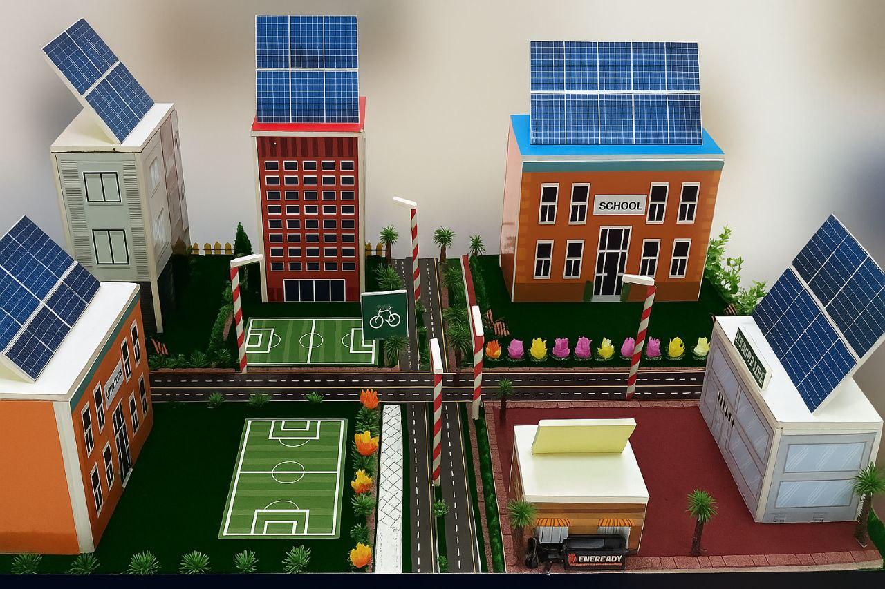

# 🏙️ Future City Project | مشروع مدينة المستقبل

> A student-designed sustainable smart city — car-free, solar-powered, and built around people.
> Website designed and built by **Mohammed Khaled** with his school team.



**Live page:** open `index.html` in any browser — no build step, no dependencies.
Bilingual: **English by default, العربية بضغطة زر.**

---

## 🇬🇧 In English

### What it is

A scale-model concept of a small sustainable city: modern houses, **two schools** and **one central market**, all within walking or cycling distance. Three systems work as one:

- **☀️ Clean energy, on site** — rooftop solar panels power homes; piezoelectric sidewalk tiles turn footsteps into electricity for streetlights and signals.
- **🚲 Car-free mobility** — short connected routes replace cars, cutting emissions, noise and danger.
- **🌬️ Buildings that breathe** — street orientation + wall openings drive natural airflow, reducing air-conditioning.

### Why it matters

| Benefit | How the design delivers it |
|---|---|
| Better daily life | Quiet streets, short walks, cleaner air |
| Protected environment | On-site renewables instead of fossil fuel |
| Less pollution & noise | No inner-city car traffic |
| Hands-on innovation | Students researching + building real systems |

### Design highlights

1. **Realistic physical model** — `city-model.jpg`
2. **Walkable street layout** — `walkable-streets.jpg`
3. **Solar-powered lighting** — `solar-panels.jpg`
4. **Footstep-energy tiles (piezoelectric)** — `piezoelectric-tiles.jpg`

### My role — Mohammed Khaled

- Co-designed the city concept and researched both energy systems (solar + piezoelectric).
- **Designed and coded this entire website from scratch** — semantic HTML, custom CSS, vanilla JS language toggle. No templates, no frameworks.
- Skills demonstrated: sustainability thinking, responsive/accessible frontend, bilingual technical communication.

### Team

- **Mohammed Khaled** — concept, energy research & website
- Saeed Hamad — model design & build
- Hamad Al Nuaimi — urban planning & build
- Mohammed Mahmoud — research & build
- Aziz Ghareeb — research & build

### Run it locally

```bash
# any static server works, or just double-click index.html
python -m http.server 8000
# → http://localhost:8000
```

To publish free on GitHub Pages: repo Settings → Pages → Deploy from branch → `main` + `/root`. Your scholarship letter can then link directly to the live page.

### Project structure

```
future-city-project/
├── index.html      # the whole site (HTML + CSS + JS, bilingual EN/AR)
├── city-model.jpg     # city model (hero + gallery)
├── walkable-streets.jpg         # walkable streets
├── solar-panels.jpg      # solar panels
├── piezoelectric-tiles.jpg        # piezoelectric tiles
├── saeed-hamad.jpg        # team photo
├── mohammed-khaled.jpg    # photo of Mohammed Khaled
└── README.md
```

---

## 🇸🇦 بالعربية

### ما هو المشروع؟

نموذج مصغّر لمدينة صغيرة مستدامة: بيوت حديثة و**مدرستان** و**سوق مركزي**، كلها على مسافة مشي أو دراجة. ثلاث منظومات تعمل كواحدة:

- **☀️ طاقة نظيفة محلية** — ألواح شمسية على الأسطح للبيوت، وبلاطات بيزوالكترك في الأرصفة تحوّل خطوات المشاة إلى كهرباء للإنارة والإشارات.
- **🚲 تنقل بلا سيارات** — طرق قصيرة متصلة تُغني عن السيارات وتخفض الانبعاثات والضوضاء.
- **🌬️ مبانٍ تتنفس** — اتجاه الشوارع وفتحات الجدران توجه الهواء الطبيعي عبر البيوت فيقل الاحتياج للمكيفات.

### دوري — محمد خالد

- شاركت في تصميم الفكرة وبحث نظامي الطاقة (الشمسية + البيزوالكترك).
- **صممت وبرمجت هذا الموقع كاملًا من الصفر** — HTML دلالي وCSS مخصص وJavaScript خالص لتبديل اللغة، دون قوالب أو أطر جاهزة.

### الفريق

- **محمد خالد** — الفكرة وبحث الطاقة والموقع
- سعيد حمد — تصميم وتنفيذ المجسّم
- حمد النعيمي — التخطيط العمراني والبناء
- محمد محمود — البحث والبناء
- عزيز غريب — البحث والبناء

### التشغيل محليًا

افتح ملف `index.html` في أي متصفح مباشرة — لا يحتاج بناءً ولا مكتبات.

---

© 2026 Future City Project • Built by Mohammed Khaled with the school team
