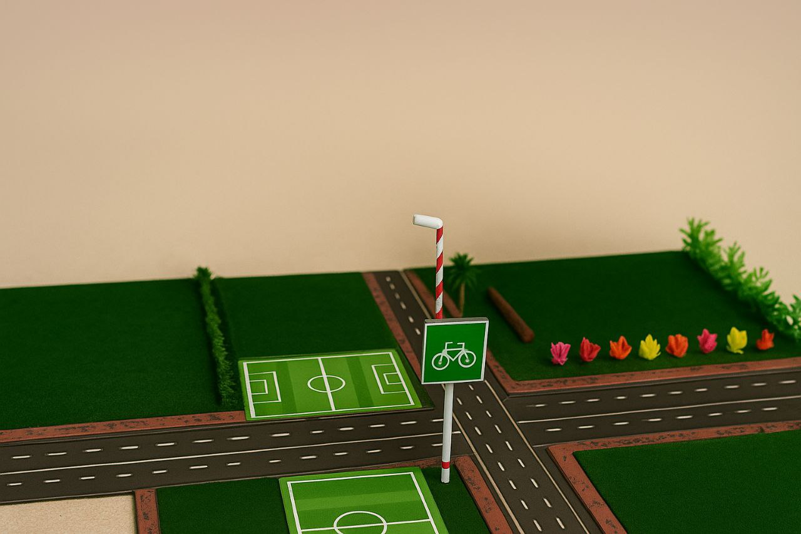
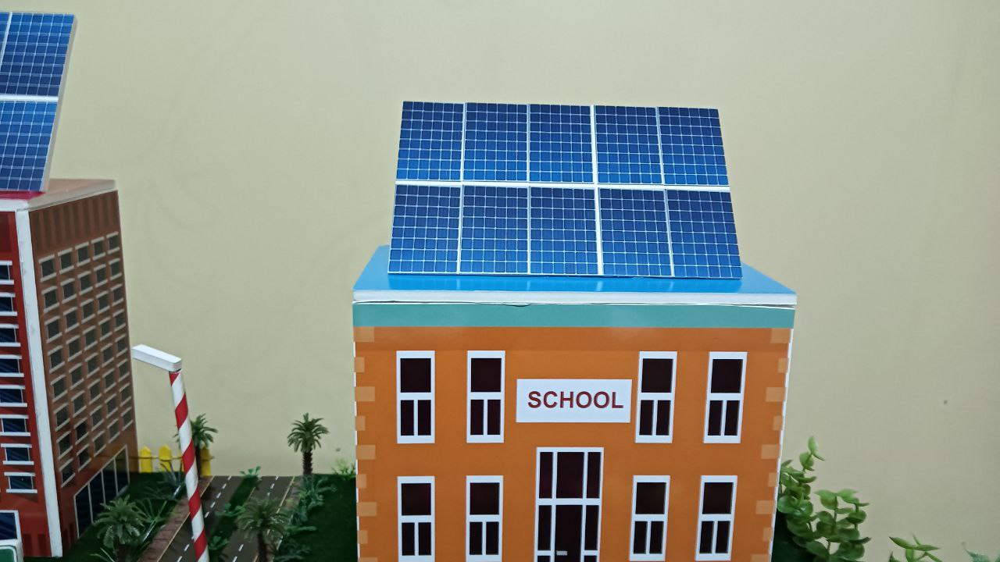
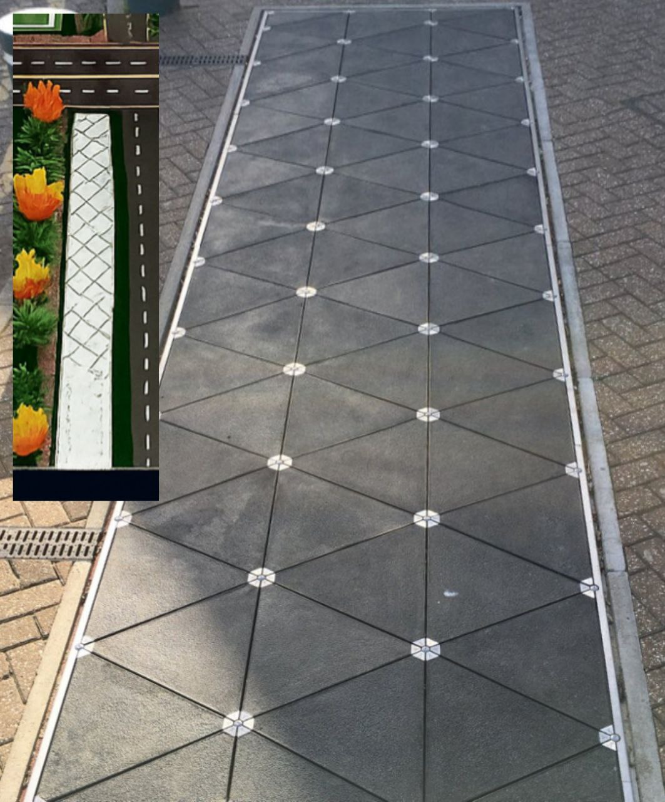

# 🏙️ مشروع مدينة المستقبل | Future City Project

---

## 🇸🇦 بالعربية

### وصف المشروع

المشروع عبارة عن مدينة مستقبلية صغيرة مصممة لتكون صديقة للبيئة وتوفر أسلوب حياة مريح ومستدام. تحتوي المدينة على مدرستين وسوبرماركت مركزي يخدم السكان، بالإضافة إلى مجموعة من المنازل الحديثة.

- **التنقل:** جميع المرافق قريبة من البيوت، فيمكن الوصول إليها بالدراجات الهوائية أو المشي دون الحاجة إلى السيارات، وهذا يقلل التلوث ويجعل المدينة أكثر هدوءًا وصحية.
- **التهوية:** تخطيط البيوت والشوارع يسمح بمرور الهواء بين المنازل، مما يقلل الحاجة إلى أجهزة التبريد. كل بيت فيه فتحات لدخول الهواء وخروجه لتجديده وتبريده بشكل طبيعي.
- **الطاقة:** ألواح شمسية على أسطح المنازل لتوليد الكهرباء النظيفة. كما تُستخدم بلاطات **البيزوالكترك (Piezoelectric)** في الأرصفة والشوارع لتحويل ضغط خطوات المشاة إلى كهرباء تشغّل إنارة الشوارع وإشارات المرور.

### المميزات

- الاعتماد على الطاقة المتجددة
- مواصلات ذكية وبدون انبعاثات
- مباني ذكية وصديقة للبيئة

### الفوائد

- تحسين جودة الحياة
- الحفاظ على البيئة
- تقليل التلوث والضوضاء
- تشجيع الابتكار والتكنولوجيا

### أهم النقاط في المشروع

**1. تصميم ثلاثي الأبعاد واقعي**

**2. محاكاة حركة المرور الذكية**

**3. نظام إضاءة يعمل بالطاقة الشمسية**

**4. استخدام بلاطات خاصة لتوليد الكهرباء عند المشي عليها (Piezoelectric)**

### فريق العمل

- سعيد حمد
- محمد خالد
- حمد النعيمي
- محمد محمود
- عزيز غريب

---

## 🇬🇧 In English

### Project Description

The project is a small futuristic city designed to be eco-friendly and provide a comfortable and sustainable lifestyle. The city includes two schools and a central supermarket serving the residents, along with a group of modern houses.

- **Transport:** All facilities are within walking or cycling distance, so cars are not needed. This reduces pollution and makes the city quieter and healthier.
- **Airflow:** Houses and streets are arranged to allow natural airflow, reducing the need for air conditioners. Each home has openings for air circulation to keep it cool naturally.
- **Energy:** Solar panels on rooftops generate clean electricity. Special **Piezoelectric** tiles on sidewalks and streets convert footsteps into electricity for powering streetlights and traffic signals.

### Features

- Dependence on renewable energy
- Smart and emission-free transportation
- Eco-friendly smart buildings

### Benefits

- Improving quality of life
- Environmental preservation
- Reducing pollution and noise
- Encouraging innovation and technology

### Main Highlights

1. Realistic 3D Design
2. Smart Traffic Simulation
3. Solar-Powered Lighting System
4. Piezoelectric Tiles for Energy Generation

### Team Members

- Saeed Hamad
- Mohammed Khaled
- Hamad Al Nuaimi
- Mohammed Mahmoud
- Aziz Ghareeb

---

© 2025 - مشروع مدينة المستقبل | مدرسة المستقبل (Future School)
